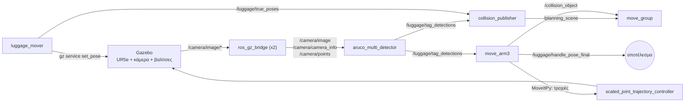

# Αναζήτηση tag ΠΡΟΟΡΙΣΜΟΥ σε βαλίτσες με βραχίονα + κάμερα (ROS 2 Jazzy)

Ένας ρομποτικός βραχίονας με κάμερα βάθους στο άκρο του επιτηρεί έναν διάδρομο
(ταινία) με βαλίτσες. Για κάθε βαλίτσα **ψάχνει** το χερούλι που έχει το ArUco
tag **ΠΡΟΟΡΙΣΜΟΥ**, το διαβάζει **μετωπικά** και δημοσιεύει τη θέση του.

- **Τώρα:** UR5e σε προσομοίωση Gazebo (ROS 2 Jazzy, MoveIt 2 / MoveItPy).
- **Τελικός στόχος:** ABB GoFa 12 (CRB 15000-12/1.27) → δες [`PORTING_GOFA12.md`](PORTING_GOFA12.md).

> Όλος ο κώδικας είναι σχολιασμένος στα ελληνικά. Το κεντρικό αρχείο
> `move_arm3.py` ξεκινά με αναλυτική περιγραφή (τι κάνει, συνδέσεις, κύκλος
> απόφασης, χάρτης αρχείου) - διάβασέ την πρώτη.

---

## Demo

- [blue_luggage_search_1.mp4](media/blue_luggage_search_1.mp4)
- [blue_luggage_search_2.mp4](media/blue_luggage_search_2.mp4)
- [orange_luggage_search_1.mp4](media/orange_luggage_search_1.mp4)
- [orange_luggage_search_2.mp4](media/orange_luggage_search_2.mp4)
- [pink_luggage_search.mp4](media/pink_luggage_search.mp4)
- [pink_luggage_search_2.mp4](media/pink_luggage_search_2.mp4)

---

## Περιεχόμενα

1. [Τι κάνει](#1-τι-κάνει)
2. [Δομή του repo](#2-δομή-του-repo)
3. [Κόμβοι και topics](#3-κόμβοι-και-topics)
4. [Απαιτήσεις](#4-απαιτήσεις)
5. [Εγκατάσταση από το μηδέν](#5-εγκατάσταση-από-το-μηδέν)
6. [Εκτέλεση της προσομοίωσης](#6-εκτέλεση-της-προσομοίωσης)
7. [Τι βλέπεις στο log](#7-τι-βλέπεις-στο-log)
8. [Ρυθμίσεις](#8-ρυθμίσεις)
9. [Μόνο για την προσομοίωση](#9-μόνο-για-την-προσομοίωση-τι-αλλάζει-στο-πραγματικό-σύστημα)
10. [Γνωστά θέματα](#10-γνωστά-θέματα)
11. [Αντιμετώπιση προβλημάτων](#11-αντιμετώπιση-προβλημάτων)
12. [Μεταφορά σε ABB GoFa 12](#12-μεταφορά-σε-abb-gofa-12)

---

## 1. Τι κάνει

### Τα tags πάνω σε κάθε βαλίτσα (λεξικό ArUco `DICT_4X4_50`)

| id | Πού βρίσκεται | Ρόλος |
|----|---------------|-------|
| 0 / 1 / 2 | στην **κορυφή** της βαλίτσας | «σώμα»: δίνει θέση + στροφή (6D pose) και ποια βαλίτσα είναι (μικρή / μεσαία / μεγάλη) |
| 4, 5 | στα **ροδάκια**, σε μία **στενή** άκρη | δείχνουν πού είναι τα ροδάκια (εκεί δεν υπάρχει ποτέ χερούλι) |
| 3 | χερούλι στη **στενή** άκρη, απέναντι από τα ροδάκια | **απλό** χερούλι (στην τωρινή ρύθμιση) |
| 6 | χερούλι σε **μακριά** πλευρά | **ΠΡΟΟΡΙΣΜΟΣ** (στην τωρινή ρύθμιση) |

Ποιο από τα 3 / 6 είναι ο προορισμός ορίζεται από **μία** γραμμή στο
`move_arm3.py`: `DEST_ON_LONG_SIDE = True` (→ id 6). Ο αλγόριθμος **δεν** το
χρησιμοποιεί για να «ξέρει» πού να ψάξει - ψάχνει πραγματικά.

### Η συμπεριφορά (ένας «κύκλος» ≈ παρατήρηση ~1 s + μία κίνηση)

1. **Ασφάλεια:** αν η κάμερα βρεθεί πολύ κοντά σε βαλίτσα → υποχωρεί και ξαναδοκιμάζει την ίδια πλευρά.
2. **Tag προορισμού ορατό** (έστω για ένα καρέ) → η αναζήτηση **σταματά**. Μένει εκεί 5 κύκλους
   (το πολύ μία μικρή διόρθωση για μετωπική θέα), δημοσιεύει τη θέση και γυρίζει σε επιτήρηση.
   **Απλό χερούλι** → η πλευρά του αποκλείεται μόνιμα.
3. **Βαλίτσα ορατή** → αναζήτηση γύρω της:
   - κατεύθυνση ροδακιών (μόνο όσο είναι άγνωστη): 2 ροδάκια ορατά → γνωστή· αλλιώς ένα ευρύ πλάνο· με 1 ροδάκι → λίγο πιο κοντά (μία φορά)·
   - σειρά πλευρών: **απέναντι από τα ροδάκια → πιο κοντινή μακριά πλευρά → πιο μακρινή μακριά πλευρά** (ακόμα και με πλήρες τέντωμα). **Ποτέ** η μεριά των ροδακιών·
   - σε κάθε πλευρά: μετωπική θέα πρώτα· έως 3 πολύ μικρές διορθώσεις **μόνο** αν το tag φάνηκε για λίγο και χάθηκε·
   - όλες οι πλευρές ελεγμένες χωρίς προορισμό → τέλος, επιτήρηση (νέος γύρος μόνο αν η βαλίτσα ξαναφανεί).
4. **Τίποτα ορατό** → επιτήρηση, εναλλάξ **μπροστά** / **πλάγια δεξιά**. Δεν ψάχνει «στο κενό» από μνήμη.

Ο βραχίονας κρατά **μνήμη** κάθε βαλίτσας (pose, ροδάκια, ποιες πλευρές ελέγχθηκαν) σε
τοπικές γωνίες, ώστε να ισχύει κι αν η βαλίτσα γυρίσει. Κάθε κίνηση ελέγχεται ώστε
**ο βραχίονας να μην κρύβει την κάμερα** (αυτο-απόκρυψη) και η κάμερα να μην
πλησιάζει βαλίτσα. Ο προσανατολισμός της κάμερας γύρω από τον άξονα θέασης είναι
ελεύθερος (το ArUco διαβάζεται και ανάποδα) και επιλέγεται η λύση με τη **μικρότερη
κίνηση αρθρώσεων**.

**Έξοδος:** `/luggage/handle_pose_final` (`geometry_msgs/PoseStamped`, frame `base_link`).

---

## 2. Δομή του repo

```
.
├── README.md                  <- αυτό το αρχείο
├── PORTING_GOFA12.md          <- οδηγίες μεταφοράς σε ABB GoFa 12
├── .gitignore
├── gazebo_models/             <- τα 3 μοντέλα βαλιτσών του Gazebo (με τα ArUco tags)
│   ├── luggage/               (μικρή,   tag σώματος id 0)
│   ├── luggage_2/             (μεσαία,  tag σώματος id 1)
│   └── luggage_3/             (μεγάλη,  tag σώματος id 2)
├── my_ur5e_controller/        <- πακέτο ROS 2 (ament_python) - ο κώδικας
│   ├── my_ur5e_controller/
│   │   ├── move_arm3.py              ο «εγκέφαλος»: αναζήτηση + κίνηση (MoveItPy)
│   │   ├── aruco_multi_detector.py   ανίχνευση ArUco με 6D pose (εικόνα + point cloud)
│   │   ├── luggage_mover.py          [προσομοίωση] κινεί τις βαλίτσες σαν ταινία
│   │   └── collision_publisher.py    βαλίτσες ως εμπόδια στο MoveIt (10 Hz)
│   ├── launch/run_move_arm3.launch.py
│   ├── config/ur5e.yaml       ρυθμίσεις βραχίονα UR5e (= προεπιλογές του κώδικα)
│   ├── config/gofa12.yaml     πρότυπο ρυθμίσεων για GoFa 12 (ΠΡΟΣ ΣΥΜΠΛΗΡΩΣΗ)
│   ├── urdf/ur5e_with_camera.xacro   UR5e + κάμερα RGB-D + gripper
│   └── meshes/gripper.stl
└── my_ur5e_moveit_config/     <- ρυθμίσεις MoveIt 2 για τον UR5e με την κάμερα
```

---

## 3. Κόμβοι και topics



| Κόμβος | Είσοδοι | Έξοδοι | Σημειώσεις |
|--------|---------|--------|------------|
| `aruco_multi_detector` | `/camera/image`, `/camera/camera_info`, `/camera/points`, TF | `/luggage/tag_detections` (`MarkerArray`, frame `base_link`) | Θέση από το point cloud, προσανατολισμός από τις 3D γωνίες του tag. Ανοίγει παράθυρο OpenCV «ArUco 6D Detection». |
| `move_arm3` (μέσω `run_move_arm3.launch.py`) | `/luggage/tag_detections`, TF `base_link → gemini_camera_link` | `/luggage/handle_pose_final`, `/collision_object` | Κινεί τον βραχίονα με MoveItPy (group `ur_manipulator`). |
| `luggage_mover` | - | `/luggage/true_poses` | **Μόνο προσομοίωση.** Μετακινεί τις οντότητες `luggage`, `luggage_2`, `luggage_3` του κόσμου `empty` με `gz service`. |
| `collision_publisher` | `/luggage/true_poses`, `/luggage/tag_detections` | `/planning_scene` | Προεπιλογή: θέσεις από τις ανιχνεύσεις. Με `-p use_truth:=true` από τον `luggage_mover`. |

---

## 4. Απαιτήσεις

| | Δοκιμασμένη έκδοση |
|---|---|
| Λειτουργικό | Ubuntu 24.04.3 LTS (σε WSL2 στα Windows) |
| ROS 2 | Jazzy |
| Gazebo | Harmonic (μέσω `ros-jazzy-ros-gz` 1.0.22) |
| MoveIt 2 | 2.12.4 (με `moveit_py`) |
| Universal Robots | `ur_simulation_gz` 2.5.0, `ur_description` 3.5.1 |
| Python | 3.12, **OpenCV 5.0.0 (pip `opencv-python==5.0.0.93`)**, numpy 1.26.4 (συστήματος), PyYAML 6.0.1 |

> **Προσοχή - OpenCV:** ο ανιχνευτής χρησιμοποιεί `cv2.aruco.ArucoDetector`, που
> υπάρχει από OpenCV **4.7** και μετά. Το `apt` του Ubuntu 24.04 δίνει 4.6 → **δεν
> αρκεί**. Εγκατάσταση με pip στο βήμα 5.3.

---

## 5. Εγκατάσταση από το μηδέν

### 5.1 ROS 2 Jazzy

Ακολούθησε τον επίσημο οδηγό (έκδοση *desktop*):
<https://docs.ros.org/en/jazzy/Installation/Ubuntu-Install-Debs.html>

### 5.2 Πακέτα συστήματος

```bash
sudo apt update
sudo apt install -y ros-jazzy-moveit ros-jazzy-moveit-py \
    ros-jazzy-ur ros-jazzy-ur-simulation-gz ros-jazzy-ros-gz \
    python3-colcon-common-extensions python3-rosdep python3-pip git
```

### 5.3 OpenCV ≥ 4.7 (με pip)

```bash
pip install --user --break-system-packages --no-deps opencv-python==5.0.0.93
python3 -c "import cv2, numpy; print(cv2.__version__, numpy.__version__, hasattr(cv2.aruco, 'ArucoDetector'))"
# αναμενόμενο:  5.0.0 1.26.4 True
```

**Γιατί `--no-deps`:** το `opencv-python 5.x` δηλώνει ότι θέλει numpy ≥ 2. Χωρίς
`--no-deps` το pip θα εγκαταστήσει numpy 2 στο `~/.local`, και τότε το `cv_bridge`
του ROS (φτιαγμένο για numpy 1.x) **σταματά να δουλεύει**. Με `--no-deps` μένει το
numpy 1.26.4 του συστήματος - αυτός είναι ο συνδυασμός που δοκιμάστηκε.

*Εναλλακτική* (αν θες χωρίς `--no-deps`): `opencv-python==4.11.0.86`, που δουλεύει
με numpy 1.26 και έχει `ArucoDetector` (δεν έχει δοκιμαστεί σε αυτό το project).

### 5.4 Workspace, εξαρτήσεις, build

```bash
mkdir -p ~/ros2_ws/src
git clone https://github.com/mariaioannidou-ece/luggage-tag-search.git ~/ros2_ws/src/luggage_repo

source /opt/ros/jazzy/setup.bash
sudo rosdep init        # μόνο την ΠΡΩΤΗ φορά στον υπολογιστή (αν πει ότι υπάρχει ήδη, αγνόησέ το)
rosdep update
cd ~/ros2_ws
rosdep install --from-paths src --ignore-src -y
colcon build
```

Αναμενόμενο: `Summary: 2 packages finished`. Έλεγχος:

```bash
source ~/ros2_ws/install/setup.bash
ros2 pkg executables my_ur5e_controller
# αναμενόμενο (4 γραμμές):
#   my_ur5e_controller aruco_multi_detector
#   my_ur5e_controller collision_publisher
#   my_ur5e_controller luggage_mover
#   my_ur5e_controller move_arm3
```

### 5.5 Μοντέλα βαλιτσών για το Gazebo

Το Gazebo πρέπει να ξέρει πού είναι τα μοντέλα **πριν** ξεκινήσει:

```bash
echo 'export GZ_SIM_RESOURCE_PATH=$GZ_SIM_RESOURCE_PATH:$HOME/ros2_ws/src/luggage_repo/gazebo_models' >> ~/.bashrc
source ~/.bashrc
```

(Ισοδύναμα: αντιγραφή των φακέλων `gazebo_models/*` στο `~/.gz/models/` και
`export GZ_SIM_RESOURCE_PATH=$GZ_SIM_RESOURCE_PATH:$HOME/.gz/models`.)

---

## 6. Εκτέλεση της προσομοίωσης

Κάθε βήμα σε **δικό του τερματικό**, με τη σειρά, αφού έχει ξεκινήσει το
προηγούμενο. Σε **κάθε** νέο τερματικό πρώτα:

```bash
source ~/ros2_ws/install/setup.bash
```

**Τ1 - Gazebo + UR5e με κάμερα**

```bash
ros2 launch ur_simulation_gz ur_sim_control.launch.py ur_type:=ur5e \
  description_file:=$(ros2 pkg prefix my_ur5e_controller)/share/my_ur5e_controller/urdf/ur5e_with_camera.xacro \
  launch_rviz:=false
```

Περίμενε να ανοίξει το Gazebo και να φορτωθούν οι controllers.

**Βήμα χεριού - βάλε τις 3 βαλίτσες στο Gazebo**

Στο Gazebo: μενού **⋮** (πάνω δεξιά) → **Resource Spawner** → *Local resources* →
σύρε μέσα στη σκηνή τα `luggage`, `luggage_2`, `luggage_3` (**μία φορά το καθένα**,
οπουδήποτε - ο `luggage_mover` τα τοποθετεί μόνος του). Στο *Entity Tree* τα
ονόματα πρέπει να είναι **ακριβώς** `luggage`, `luggage_2`, `luggage_3`.

**Τ2 - γέφυρα κάμερας: εικόνα + camera_info**

```bash
ros2 run ros_gz_bridge parameter_bridge \
  /camera/image/image@sensor_msgs/msg/Image[gz.msgs.Image \
  /camera/image/camera_info@sensor_msgs/msg/CameraInfo[gz.msgs.CameraInfo \
  --ros-args -r /camera/image/image:=/camera/image -r /camera/image/camera_info:=/camera/camera_info
```

**Τ3 - γέφυρα κάμερας: point cloud** (το χρειάζεται ο ανιχνευτής για το βάθος)

```bash
ros2 run ros_gz_bridge parameter_bridge \
  /camera/image/points@sensor_msgs/msg/PointCloud2[gz.msgs.PointCloudPacked \
  --ros-args -r /camera/image/points:=/camera/points
```

**Τ4 - MoveIt move_group**

```bash
ros2 launch my_ur5e_moveit_config move_group.launch.py
```

**Τ5 - RViz** *(προαιρετικό, μόνο για οπτικοποίηση)*

```bash
ros2 launch my_ur5e_moveit_config moveit_rviz.launch.py
```

**Τ6 - ανιχνευτής ArUco** (ανοίγει παράθυρο με την εικόνα και τα tags)

```bash
ros2 run my_ur5e_controller aruco_multi_detector
```

**Τ7 - κίνηση βαλιτσών** (ταινία stop-and-go)

```bash
ros2 run my_ur5e_controller luggage_mover
```

**Τ8 - εμπόδια για το MoveIt**

```bash
ros2 run my_ur5e_controller collision_publisher
```

**Τ9 - ο βραχίονας**

```bash
ros2 launch my_ur5e_controller run_move_arm3.launch.py
```

### Χρήσιμα

```bash
ros2 run rqt_image_view rqt_image_view            # τι βλέπει η κάμερα
ros2 topic echo /luggage/handle_pose_final        # το αποτέλεσμα
ros2 topic hz /camera/points                      # έρχεται point cloud;
```

Παράμετροι του `luggage_mover` (παράδειγμα: `ros2 run my_ur5e_controller luggage_mover --ros-args -p dwell:=60.0 -p random_stops:=true`):

| Παράμετρος | Προεπιλογή | Τι κάνει |
|---|---|---|
| `world` | `empty` | όνομα κόσμου του Gazebo |
| `y` | 0.60 | απόσταση ταινίας από τη βάση (m) |
| `x_start` / `x_end` | 2.70 / -2.70 | από πού ως πού κινούνται (m) |
| `speed` | 0.5 | ταχύτητα ταινίας (m/s) |
| `spacing` | 1.80 | απόσταση μεταξύ βαλιτσών (m) |
| `dwell` | 90.0 | πόσα s σταματά η ταινία μπροστά στον βραχίονα |
| `pause` | false | πάγωμα ταινίας |
| `random_stops` | false | τυχαίο σημείο στάσης (±0.35 m) |
| `yaw_1` / `yaw_2` / `yaw_3` | 0 / 45 / -90 | στροφή κάθε βαλίτσας (μοίρες) |
| `face_arm_3`, `handle_local_deg`, `jitter_deg` | true, 0, 35 | τυχαία στροφή της 3ης βαλίτσας σε κάθε πέρασμα |

---

## 7. Τι βλέπεις στο log

Στην εκκίνηση το `move_arm3` τυπώνει τις ρυθμίσεις του βραχίονα που φόρτωσε
(`=== Ρυθμίσεις βραχίονα: ... ===`) - **έλεγξέ τες**. Μετά, σε κάθε κύκλο:

| Γραμμή | Σημασία |
|---|---|
| `ΚΥΚΛΟΣ n` | αρχή κύκλου |
| `[ΜΝΗΜΗ] ...` | τι θυμάται για τη βαλίτσα (pose, ροδάκια, ελεγμένες πλευρές) |
| `>>> ΣΤΟΧΟΣ: ...` | είδε το tag προορισμού - η αναζήτηση σταματά |
| `*** ΕΠΙΒΕΒΑΙΩΘΗΚΕ ...` | έμεινε τους κύκλους που πρέπει και δημοσίευσε τη θέση |
| `>>> ΕΠΙΤΗΡΗΣΗ ...` | θέση επιτήρησης (μπροστά / πλάγια δεξιά) |
| `!!! ΚΙΝΔΥΝΟΣ ΣΥΓΚΡΟΥΣΗΣ ...` | κάμερα πολύ κοντά σε βαλίτσα → υποχώρηση |

---

## 8. Ρυθμίσεις

### 8.1 Ρυθμίσεις βραχίονα (YAML) - χωρίς αλλαγή κώδικα

Ό,τι εξαρτάται από τον βραχίονα διαβάζεται από ένα YAML:

```bash
ros2 launch my_ur5e_controller run_move_arm3.launch.py \
  robot_config:=$(ros2 pkg prefix my_ur5e_controller)/share/my_ur5e_controller/config/ur5e.yaml
```

Χωρίς `robot_config` ισχύουν οι προεπιλογές UR5e (ίδιες με το `config/ur5e.yaml`).
Άγνωστο κλειδί στο YAML = ο κόμβος **σταματά με σφάλμα** (προστασία από τυπογραφικά).

| Κλειδί | Τι είναι | UR5e |
|---|---|---|
| `planning_group` | group του MoveIt (από το SRDF) | `ur_manipulator` |
| `camera_link` | frame της κάμερας που κινείται (+X = θέαση, **όχι** optical) | `gemini_camera_link` |
| `base_frame` | frame όλων των συντεταγμένων | `base_link` |
| `self_links` | σύνδεσμοι βάση → κάμερα, για τον έλεγχο αυτο-απόκρυψης | `shoulder_link` … `gripper_link` |
| `link_radius` | μισό πάχος συνδέσμου (m) | 0.075 |
| `max_reach` / `min_reach` | όρια απόστασης κάμερας-βάσης (m) | 0.93 / 0.22 |
| `workable_dist` | πέρα από αυτό μια βαλίτσα αγνοείται ως στόχος (m) | 0.85 |
| `ik_timeout` | χρόνος IK ανά δοκιμή (s) | 0.03 |
| `small_move_deg` | «μικρή» κίνηση αρθρώσεων (μοίρες) | 30 |
| `settle` | αναμονή μετά από κάθε κίνηση (s) | 0.7 |
| `camera_hfov`, `camera_width`, `camera_height` | οπτικό πεδίο κάμερας | 1.64 rad, 1280×800 |
| `watch_forward`, `watch_right` | θέσεις επιτήρησης `[[θέση κάμερας],[σημείο θέασης]]` | δες `ur5e.yaml` |
| `face_views`, `elevate_views`, `handle_standoffs` | αποστάσεις θέασης (εξαρτώνται από κάμερα/tag) | δες `ur5e.yaml` |

### 8.2 Σταθερές μέσα στο `move_arm3.py`

| Σταθερά | Τιμή | Τι κάνει |
|---|---|---|
| `DEST_ON_LONG_SIDE` | `True` | `True` → προορισμός το id 6 (μακριά πλευρά), `False` → το id 3 |
| `DEST_STAY_CYCLES` | 5 | κύκλοι παραμονής μπροστά στο tag προορισμού |
| `MAX_RELOOK` | 3 | μικρές διορθώσεις όταν ο προορισμός φάνηκε και χάθηκε |
| `DONE_CYCLES` | 10 | μετά από τόσους κύκλους ξαναελέγχεται η ίδια βαλίτσα (προσομοίωση) |
| `BODY_IDS` | - | διαστάσεις (L, W, H) κάθε βαλίτσας ανά id σώματος |

### 8.3 Σταθερές στον ανιχνευτή (`aruco_multi_detector.py`, στην αρχή του αρχείου)

`TARGET_FRAME = 'base_link'`, `RAW_POINT_FRAME = 'gemini_camera_link'`,
`OPTICAL_FRAME = 'gemini_camera_link_optical'`, και στο `TAG_REGISTRY` το
**μέγεθος κάθε tag** (π.χ. σώμα 0.0713 m, id 6: 0.0434 m). Αλλάζουν μόνο αν
αλλάξουν τα frames της κάμερας ή τα φυσικά tags.

---

## 9. Μόνο για την προσομοίωση: τι αλλάζει στο πραγματικό σύστημα

| Τι | Στην προσομοίωση | Στο πραγματικό σύστημα |
|---|---|---|
| `luggage_mover` | κινεί τις βαλίτσες στο Gazebo | **δεν τρέχει** |
| Γέφυρες `ros_gz_bridge` | εικόνα / point cloud από το Gazebo | ο **driver της κάμερας** (remap στα `/camera/image`, `/camera/camera_info`, `/camera/points`) |
| `DONE_CYCLES` | ξαναελέγχει την ίδια βαλίτσα (δεν φεύγει ποτέ) | να ξανασκεφτεί |
| `max_velocity_scaling_factor` στο launch | 1.0 | **0.1 - 0.2** |
| `use_sim_time` στο launch | `True` | `False` |
| `BODY_IDS` / `TAG_REGISTRY` | διαστάσεις μοντέλων Gazebo, μεγέθη tags | πραγματικές διαστάσεις, **μετρημένα** μεγέθη tags |
| `collision_publisher -p use_truth:=true` | ακριβείς θέσεις από τον mover | δεν υπάρχει «αλήθεια» - μόνο ανιχνεύσεις |

> **Ασφάλεια:** ο έλεγχος σύγκρουσης του κώδικα **δεν είναι σύστημα ασφαλείας**.
> Στον πραγματικό βραχίονα: safety zones στον controller, χαμηλές ταχύτητες,
> χέρι στο emergency stop.

---

## 10. Γνωστά θέματα

- **Ίδια ονόματα εμποδίων:** ο `collision_publisher` και το `move_arm3` δημοσιεύουν
  εμπόδια με τα **ίδια** ids (`ground_plane`, `suitcase_0/1/2`). Ισχύει όποιο γράψει
  τελευταίο. Στην προσομοίωση είναι ακίνδυνο (ίδιες διαστάσεις)· αν αλλάξει κάποιος
  από τους δύο, να το έχεις υπόψη.
- **Παράθυρο OpenCV:** ο ανιχνευτής ανοίγει παράθυρο (`cv2.imshow`) → χρειάζεται
  γραφικό περιβάλλον (στο WSL2 δουλεύει μέσω WSLg).
- **Κάμερα Gazebo:** βλέπει ως 2.0 m (`clip far`)· ο ανιχνευτής κρατά βάθη 0.05-1.9 m.
- **Μοντέλο ML (YOLO):** ο ανιχνευτής βαλιτσών με νευρωνικό δεν είναι μέρος αυτής
  της έκδοσης. Τα βάρη (`best_suitcase_17_7_2026.pt`) **δεν** ανεβαίνουν στο repo·
  διαθέσιμα κατόπιν αιτήματος.

---

## 11. Αντιμετώπιση προβλημάτων

| Σύμπτωμα | Αιτία / λύση |
|---|---|
| `luggage_mover`: `gz service απέτυχε` | οι βαλίτσες δεν μπήκαν στο Gazebo, ή δεν λέγονται ακριβώς `luggage`, `luggage_2`, `luggage_3`, ή ο κόσμος δεν λέγεται `empty` |
| Οι βαλίτσες δεν φαίνονται στο Resource Spawner / δεν έχουν υφή | λείπει το `GZ_SIM_RESOURCE_PATH` (βήμα 5.5) - πρέπει να έχει οριστεί **πριν** ξεκινήσει το Gazebo |
| `AttributeError: ... has no attribute 'ArucoDetector'` | OpenCV < 4.7 → βήμα 5.3 |
| `A module that was compiled using NumPy 1.x cannot be run in NumPy 2...` | μπήκε numpy 2 στο `~/.local` → `pip uninstall numpy` (του χρήστη) και ξανά βήμα 5.3 με `--no-deps` |
| `python3 -c "import cv2; print(cv2.__version__)"` δείχνει 4.6 | χρησιμοποιείται το OpenCV του apt → βήμα 5.3 |
| Δεν έρχονται ανιχνεύσεις | `ros2 topic hz /camera/image` και `/camera/points` - τρέχουν οι γέφυρες Τ2 / Τ3; |
| `move_arm3` σταματά με σφάλμα για άγνωστο κλειδί | τυπογραφικό στο YAML του `robot_config` - δες τον πίνακα 8.1 |
| Ο βραχίονας δεν κινείται | φορτώθηκαν οι controllers στο Τ1 (`ros2 control list_controllers` → `scaled_joint_trajectory_controller` *active*); |

---

## 12. Μεταφορά σε ABB GoFa 12

Δες το [`PORTING_GOFA12.md`](PORTING_GOFA12.md): τι είναι φτιαγμένο ειδικά για τον
UR5e, τι αλλάζει με YAML και τι χρειάζεται νέο (URDF, ρυθμίσεις MoveIt, driver).

---

## Άδεια

`my_ur5e_controller`: Apache-2.0 · `my_ur5e_moveit_config`: BSD-3-Clause
